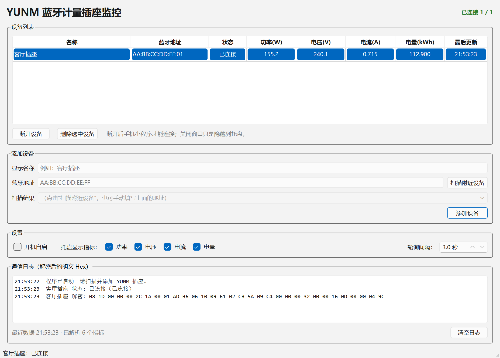

# 上海人民断路器 · 蓝牙计量插座 Windows 监控

> 用 Windows 电脑直接读取 **上海人民断路器** 蓝牙计量插座的数据，常驻系统托盘，不再依赖微信小程序 **控控乐**。




> **免责声明**
>
> 这是一个个人学习 / 自己设备互操作项目，**与上海人民断路器、控控乐官方没有任何隶属关系**。
> 项目通过公开的 BLE GATT 接口读取自己购买的计量插座数据，不修改设备固件、不绕过付费功能。
> 请仅对自己拥有的设备使用，并遵守当地法律和设备使用条款。商标归各自权利人所有。

---

## 功能

- **直接 BLE 读取**：扫描、连接、订阅 TX、轮询 RX，不依赖微信小程序或厂商云端
- **实时指标**：功率、电压、电流、累计电量、功率因数、累计金额
- **多设备**：每台插座独立连接、断线重连、独立显示
- **系统托盘**：动态 Tooltip，例如 `客厅插座: 156W 240.1V | 书房插座: 断线`
- **状态颜色**：黄=连接中，绿=正常，红=断线
- **设备级断开/恢复**：一键释放 BLE，让手机小程序连接；断开状态持久化
- **开机自启**：写入 `HKCU\Software\Microsoft\Windows\CurrentVersion\Run`
- **单文件 exe**：PyInstaller onefile，目标电脑**不需要安装 Python**
- **完整中文界面 + 日志**

## 直接使用 exe

1. 把 `YUNM-Plug-Monitor.exe` 和 `config.json` 放在同一个文件夹；
2. 双击 exe；
3. 首次使用点“扫描附近设备”，添加名称以 `YUNM` 开头的插座；
4. 程序会自动连接并读取，关闭窗口只是隐藏到托盘。

> exe 是 PyInstaller 单文件程序，运行时会把依赖解压到临时目录，**不需要 Python 环境**。
> 如果杀毒软件误报 onefile，请把程序目录加入白名单，或使用源码方式运行。

## 从源码运行

```powershell
git clone <your-repo-url>
cd <repo>
python -m pip install -r requirements.txt
python main.py
```

调试时不创建托盘：

```powershell
python main.py --no-tray
```

## 打包单文件 exe

```powershell
python -m pip install pyinstaller

pyinstaller --noconfirm --clean --onefile --windowed `
  --name "YUNM-Plug-Monitor" `
  --icon "app.ico" `
  --add-data "app.ico;." `
  --hidden-import "pystray._win32" `
  --hidden-import "bleak.backends.winrt.client" `
  --hidden-import "bleak.backends.winrt.scanner" `
  main.py
```

生成：

```text
dist\YUNM-Plug-Monitor.exe
```

`winrt-runtime` 自带 PyInstaller hook，一般不需要手动 `--collect-all winrt`。
如果打包后提示缺少 `winrt`，再追加 `--collect-all winrt`。

## 协议说明

设备使用 Microchip 透明 UART 风格服务：

```text
设备名前缀 : YUNM
Service    : 49535343-fe7d-4ae5-8fa9-9fafd205e455
RX (Write) : 49535343-8841-43f4-a8d4-ecbe34729bb3
TX (Notify): 49535343-1e4d-4bd9-ba61-23c647249616
```

### 查询命令

命令按设备 MAC 动态生成，不是固定字节：

```text
明文帧：EC ED 00 03 4B 43 4B <CRC16>
XOR key：MAC 六字节之和 & 0xFF
```

对示例 MAC `AA:BB:CC:DD:EE:FF`，程序会自动算出对应的 9 字节命令。

### 返回数据

插座返回：

```text
EC ED | 长度(2) | 数据(32) | CRC(2)
```

通知可能拆成 `20 + 18` 字节，程序会自动拼接。数据段再与 `0x63` 异或，然后按大端解析：

| 字段 | 偏移 | 解析 |
| --- | ---: | --- |
| 累计电量 | 5 | 大端 / 100，kWh |
| 功率 | 11 | 大端 / 10，W |
| 电压 | 13 | 大端 / 10，V |
| 电流 | 15 | 大端 / 1000，A |
| 功率因数 | 17 | / 100 |
| 累计金额 | 26 | 大端 / 100，元 |

完整逆向过程、HCI 抓包方法和验证记录见 [PROTOCOL_NOTES.md](PROTOCOL_NOTES.md)。

## 配置

配置保存在 exe 同目录的 `config.json`；如果目录不可写，会回退到：

```text
%APPDATA%\YUNM-PLUG-MONITOR\config.json
```

示例：

```json
{
  "devices": [
    {"name": "客厅插座", "address": "AA:BB:CC:DD:EE:FF"}
  ],
  "paused_devices": [],
  "metrics": {
    "power": true,
    "voltage": true,
    "current": true,
    "energy": true
  },
  "poll_interval": 3.0,
  "scan_timeout": 8.0,
  "auto_start": false
}
```

> 请不要把包含自己设备 MAC 的 `config.json` 提交到公开仓库。

## 让手机小程序连接

BLE 插座同一时间通常只接受一个中心设备连接。需要手机小程序连接时：

1. 在电脑端选中插座，点 **“断开设备”**；
2. 状态变成灰色 **“已断开”** 后，再用手机小程序连接；
3. 手机用完后，在小程序里断开，电脑端点 **“恢复连接”**。

断开状态会写入 `config.json` 的 `paused_devices`，重启程序不会自动抢连。

## 开机自启

在界面勾选“开机自启”即可写入当前用户注册表：

```text
HKEY_CURRENT_USER\Software\Microsoft\Windows\CurrentVersion\Run
```

- 源码运行：命令为 `python.exe "main.py"`；
- exe 运行：命令为 exe 路径；
- 移动项目/exe 后，取消再重新勾选一次。

## 项目结构

```text
.
├─ main.py              # Qt 主循环、托盘、跨线程 Signal 桥
├─ gui.py               # PySide6 主界面、设备/指标管理
├─ ble_manager.py       # asyncio BLE、命令生成、分片拼接、解析
├─ utils.py             # 配置、路径、开机自启、日志
├─ pair_test.py         # 一次性配对诊断脚本
├─ replay_test.py       # 命令重放诊断脚本
├─ PROTOCOL_NOTES.md    # 协议逆向记录
├─ app.ico
├─ docs/screenshot.png
├─ requirements.txt
└─ config.example.json
```

## 已知限制

- 主要在 Windows 10/11 + 普通 BLE 适配器上测试；
- 不同批次/固件的插座，命令中的 `4B 43 4B` 和数据偏移可能需要重新确认；
- 同一时间只能有一个设备连接插座；电脑连着时手机小程序连不上，这是 BLE 外设限制；
- 开机自启是**当前用户**级别，不是系统服务；
- 本项目不提供云端协议或官方账号相关能力。

## License

MIT License，详见 [LICENSE](LICENSE)。
